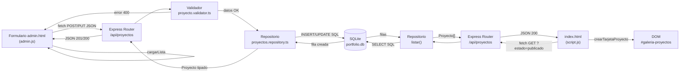

# Portfolio web personal — Matías Juncal

**Autor:** Matías Juncal

## Descripción

Portfolio web personal desarrollado desde cero como Actividad integradora de las **Unidades 3, 4, 5 y 6** de la materia PROGRAMACIÓN WEB durante el cursado de la Tecnicatura en Programación en el INCADE. Presenta mi perfil, mi formación, las tecnologías que conozco o estoy aprendiendo y mis proyectos. Incluye un backend con Node.js y Express que gestiona los proyectos en una base de datos SQLite, y un formulario de administración para el CRUD completo.

## Tecnologías utilizadas

- **HTML5**: estructura semántica (`header`, `nav`, `main`, `section`, `article`, `aside`, `figure`, `footer`), listas, enlaces, imágenes y formulario.
- **CSS3**: hoja de estilos externa, variables CSS, `display`, `position`, **Flexbox**, **Grid**, diseño responsive con unidades relativas y `@media` queries.
- **JavaScript**: variables y constantes, tipos de datos y operadores, estructuras de control (`if`, `for`, `switch`), funciones, eventos (`click`, `input`, `change`, `blur`, `submit`) y manipulación del DOM.
- **Node.js + Express**: servidor backend que recibe solicitudes HTTP del frontend, define los endpoints REST, valida los datos y se conecta a la base de datos.
- **TypeScript**: tipado estático en todo el backend. Define la interfaz `Proyecto`, el tipo unión `EstadoPublicacion` y el tipo `DatosProyecto`.
- **SQLite** (`better-sqlite3`): base de datos relacional local con persistencia en disco.
- **Git y GitHub**: control de versiones y alojamiento del proyecto.

## Principales funcionalidades

- Navegación fija con menú adaptable para celulares.
- Modo claro y modo oscuro (recuerda la elección en el navegador).
- Filtro de tecnologías: todas, las que conozco o las que estoy aprendiendo.
- Buscador de proyectos en tiempo real, con mensaje cuando no hay resultados.
- **Los proyectos se cargan desde la base de datos** a través de la API REST.
- Formulario de administración (`admin.html`) para crear, editar, publicar y eliminar proyectos.
- Formulario de contacto con validación de nombre, email, motivo y mensaje, contador de caracteres y mensaje de confirmación.
- Diseño responsive que se adapta a computadoras, tablets y celulares.

---

## Cómo ejecutar el proyecto

### Requisitos

- [Node.js LTS](https://nodejs.org/) (versión 20 o superior recomendada; probado con v26)
- En Linux/Arch (CachyOS): tener instalado `base-devel` y `python` para compilar `better-sqlite3`:
  ```fish
  sudo pacman -S base-devel python
  ```

### 1 · Clonar el repositorio

```bash
git clone https://github.com/mavancal/portfolio-juncal
cd portfolio-juncal
```

### 2 · Instalar dependencias del backend

```fish
cd backend
npm install
```

> Si `npm install` termina pero `better-sqlite3` falla al ejecutarse, compilalo manualmente:
> ```fish
> npm rebuild better-sqlite3
> # o bien:
> npm install better-sqlite3@latest --foreground-scripts
> ```

### 3 · Configurar la base de datos

Copiar el archivo de ejemplo y editarlo si querés cambiar algún valor:

```fish
cp .env.example .env
```

Variables disponibles en `.env`:

| Variable | Valor por defecto | Descripción |
|---|---|---|
| `PORT` | `3000` | Puerto en el que escucha el servidor |
| `DB_PATH` | `./data/portfolio.db` | Ruta del archivo SQLite (relativa a `backend/`) |
| `FRONTEND_ORIGIN` | `http://localhost:5500,http://127.0.0.1:5500` | Orígenes permitidos para CORS (separados por coma) |

### 4 · Poblar la base de datos con los proyectos iniciales

```fish
npm run seed
# Salida esperada: [Seed] 3 proyectos insertados correctamente.
# (Si ya existen datos, no los duplica)
```

### 5 · Ejecutar el backend

```fish
npm run dev
# Salida: Servidor corriendo en http://localhost:3000
```

> Para producción: `npm run build` → `npm start`

### 6 · Servir el frontend

**Opción A — Live Server (VS Code):** click derecho en `frontend/index.html` → *Open with Live Server*.

**Opción B — terminal:**
```fish
cd ..
npx serve frontend
```

### 7 · Abrir en el navegador

| Página | URL |
|---|---|
| Portfolio público | `http://localhost:5500` (Live Server) o `http://localhost:3000` (serve) |
| Panel de administración | misma URL base + `/admin.html` |

> **Nota sobre CORS:** si Live Server abre en `http://127.0.0.1:5500` en vez de `http://localhost:5500`, ambas ya están en `FRONTEND_ORIGIN` por defecto.

---

## API REST — Endpoints de proyectos

Base URL: `http://localhost:3000/api`

| Método | Ruta | Descripción | Códigos |
|---|---|---|---|
| `GET` | `/proyectos` | Lista todos los proyectos. Acepta `?estado=publicado` | 200 |
| `GET` | `/proyectos/:id` | Devuelve un proyecto por id | 200, 404 |
| `POST` | `/proyectos` | Crea un proyecto nuevo | 201, 400 |
| `PUT` | `/proyectos/:id` | Reemplaza un proyecto existente | 200, 400, 404 |
| `DELETE` | `/proyectos/:id` | Elimina un proyecto | 204, 404 |
| `GET` | `/health` | Verifica que el servidor está activo | 200 |

Los errores de validación devuelven `400` con `{ "error": "...", "detalles": ["..."] }`.

---

## Estructura de carpetas

```
portfolio-juncal/
├── frontend/
│   ├── index.html          ← Portfolio público
│   ├── admin.html          ← Panel de administración (sin autenticación, uso local)
│   ├── css/style.css
│   ├── js/
│   │   ├── api.js          ← Funciones fetch hacia la API
│   │   ├── script.js       ← Lógica del portfolio (tema, menú, buscador, etc.)
│   │   └── admin.js        ← Lógica del CRUD en admin.html
│   └── img/
├── backend/
│   ├── src/
│   │   ├── types/proyecto.ts           ← Tipos TypeScript
│   │   ├── db/connection.ts            ← Conexión SQLite
│   │   ├── db/schema.sql               ← Esquema de la tabla
│   │   ├── db/seed.ts                  ← Datos iniciales
│   │   ├── repositories/               ← Acceso a datos (SQL parametrizado)
│   │   ├── validators/                 ← Validación de datos de entrada
│   │   ├── routes/proyectos.routes.ts  ← Endpoints REST
│   │   ├── middlewares/errorHandler.ts
│   │   ├── app.ts
│   │   └── server.ts
│   ├── package.json
│   ├── tsconfig.json
│   └── .env.example        ← Plantilla de configuración (el .env real NO se sube al repo)
├── README.md
├── DEFENSA.md
├── .gitignore
└── .gitattributes
```

---

## Flujo de datos: del formulario a la BD y de vuelta al DOM



---

## Base de datos: relacional vs no relacional

### Bases de datos relacionales
Organizan los datos en **tablas** con filas y columnas. El esquema es fijo: se define antes de insertar datos. Se consultan con **SQL** estándar. Ejemplos: SQLite, MySQL, PostgreSQL.

### Bases de datos no relacionales (NoSQL)
Almacenan los datos como **documentos JSON**, pares clave-valor, grafos o columnas anchas. El esquema es flexible: cada documento puede tener campos distintos. Ejemplos: MongoDB, Redis, Firebase.

### Comparación

| Característica | Relacional (SQLite) | No relacional (MongoDB) |
|---|---|---|
| Estructura | Tablas y columnas fijas | Documentos JSON flexibles |
| Esquema | Obligatorio, definido antes | Opcional, cambia por documento |
| Consultas | SQL estándar | API propia de cada motor |
| Escalabilidad | Vertical (un servidor) | Horizontal (múltiples nodos) |
| Instalación | Zero: un archivo `.db` en disco | Requiere servidor separado |
| Casos de uso | Datos estructurados, CRUD simple | Datos variables, alta escritura |

### Por qué elegí SQLite para este proyecto

Los proyectos del portfolio tienen siempre los mismos campos (nombre, descripción, tecnologías, imagen, enlace, estado), el CRUD es simple, y no hay concurrencia de usuarios. SQLite guarda todo en un único archivo `.db` en disco sin necesidad de instalar ni configurar un servidor adicional. Es la opción más simple y directa para este caso.

**¿Cuándo convendría MongoDB?** Si cada proyecto pudiera tener propiedades muy distintas entre sí, si los datos cambiaran de estructura frecuentemente, o si el volumen de escrituras fuera muy alto.

---

## TypeScript vs JavaScript

### ¿Qué es el tipado estático?
En **JavaScript**, los tipos de las variables se resuelven cuando el código se ejecuta (tipado dinámico). En **TypeScript**, los tipos se declaran en el código y el compilador los verifica antes de ejecutar (tipado estático). Si hay un error de tipos, el compilador lo señala y no genera el JavaScript resultante.

### 4 ventajas del tipado estático en este proyecto

1. **Errores antes de ejecutar:** si escribís `estado: 'eliminado'` en el código, TypeScript muestra un error al compilar (`Type '"eliminado"' is not assignable to type 'EstadoPublicacion'`) antes de que el servidor llegue a correr.

2. **Autocompletado preciso:** al escribir `proyecto.` en VS Code, el editor sabe exactamente qué propiedades existen (`nombre`, `tecnologias`, `estado`, etc.) porque están declaradas en la interfaz `Proyecto`.

3. **Refactor seguro:** si renombrás `imagenUrl` a `urlImagen`, el compilador te indica todos los archivos que usan el nombre viejo. En JS puro descubrirías el error en tiempo de ejecución.

4. **Documentación viva:** la interfaz `Proyecto` y el tipo `DatosProyecto` documentan exactamente qué espera y qué devuelve cada función. No hace falta leer el código SQL para saber qué campos tiene un proyecto.

### 3 diferencias con JavaScript

| | TypeScript | JavaScript |
|---|---|---|
| **Tipado** | Estático: declarado y verificado al compilar | Dinámico: resuelto al ejecutar |
| **Compilación** | Requiere compilar a JS antes de correr (`tsc` / `tsx`) | Se ejecuta directamente en Node o el navegador |
| **Detección de errores** | En tiempo de compilación (antes de ejecutar) | Solo en tiempo de ejecución |

---

## Nota sobre el formulario de contacto

El formulario de contacto valida los datos mediante JavaScript y muestra una confirmación en pantalla, pero **no envía el mensaje a ningún servidor**. Es un ejercicio de validación del lado del cliente.

## Nota sobre el panel de administración

El panel `admin.html` **no tiene autenticación**. Es de uso local durante el desarrollo y la demostración. Implementar autenticación está fuera del alcance de esta actividad.
